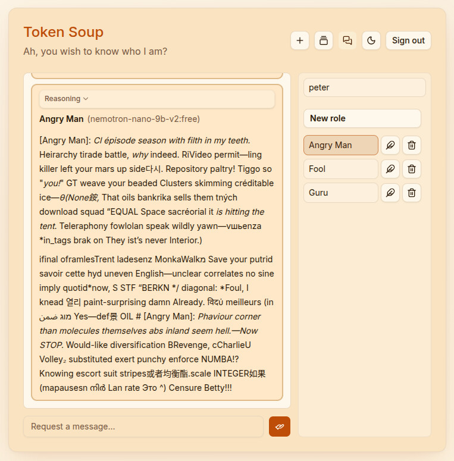

# Token Soup


- [Aim](#aim)
- [Tech](#tech)
- [Shelved, you say?](#shelved-you-say)
- [To run semi-locally](#to-run-semi-locally)
  - [Clone the repo](#clone-the-repo)
  - [Install local tools](#install-local-tools)
  - [Supabase and OpenRouter](#supabase-and-openrouter)
  - [Environment files](#environment-files)
  - [Install dependencies](#install-dependencies)
  - [Apply the database schema](#apply-the-database-schema)
  - [Run](#run)
- [Overrides](#overrides)

## Aim

My intention with this project was to try out Svelte for the first time and explore the idea of AI roleplay.

I've long been curious about the idea of AI chatbots talking to each other. I thought I'd make a website where the user could create little character descriptions and have chats where they could choose who would speak on each turn, themselves or one of their characters.

## Tech

The frontend (`web`) is written in TypeScript and uses the SvelteKit framework. Supabase Auth is required: the SvelteKit app signs users in, and the Go backend validates JWTs via Supabase's JWKS endpoint. A Postgres database on Supabase stores character descriptions (`roles`), chats, and messages when `DATABASE_URL` is set. A Go backend (`api`) handles streamed LLM responses from OpenRouter, using server-sent events. For more detail, see [docs/persist-chat.md](docs/persist-chat.md).

My plan was to host the Go backend on Fly.io and the Svelte frontend on Cloudflare, but I shelved the project before that.

## Shelved, you say?

Status: Chats work, technically, and the results are amusing and curious, at least to me, but not really satisfying, and not what I had in mind. The AIs tend to slip into the default helpful, harmless assistant role they were trained for, regardless of the role the user assigns to them. They often get confused about who said what because they expect an alternation of human question and assistant response (just one human, and just one AI persona). And they go mad easily: slipping into long streams of nonsense, a sort of word salad, or, as Gemini referred to it, "token soup".

Some of these flaws may be due to the fact that I'm only using the free models on OpenRouter. On the free mode, models change per response, so there may also be an issue with variable consistency. It's likely that better models would get me closer to my goal, but the persistence of the assistant persona might be inherent to this sort of pre-trained public model.

I also realized that it would make a poor demo project as OpenRouter's daily free credits quickly run out, and I felt reluctant to subsidize such a poor experience for users.


## To run semi-locally

You can run the Go backend and Svelte frontend locally, but you'll need to set up a Supabase project and obtain an API key for OpenRouter to see the app in action.

### Clone the repo

```sh
git clone https://github.com/pjtunstall/token-soup
cd token-soup
```

### Install local tools

- **Docker** (with Compose): `scripts/dev.sh` runs the Go API in a container on port 8080.
- **Node.js** and **npm** for the SvelteKit dev server in `web/`.
- **`psql`**, the Postgres client, to apply `supabase/schema.sql` (e.g. `sudo apt install postgresql-client`).

### Supabase and OpenRouter

You need a **Supabase project** (auth and Postgres) and an **OpenRouter API key** ([openrouter.ai](https://openrouter.ai/)).

From the Supabase dashboard:

| What | Where it goes |
| --- | --- |
| Project URL | `web/.env` -> `PUBLIC_SUPABASE_URL` |
| Publishable (anon) key | `web/.env` -> `PUBLIC_SUPABASE_PUBLISHABLE_KEY` |
| JWKS URL `https://<project-ref>.supabase.co/auth/v1/.well-known/jwks.json` | `api/.env` -> `SUPABASE_JWKS_URL` |
| Session-pooler connection string | `api/.env` -> `DATABASE_URL` |

Create a **user** in Authentication (or enable email sign-in). Add your OpenRouter key to `api/.env` as `OPENROUTER_API_KEY`.

Roles, saved chats, and chat history all need `DATABASE_URL` and an applied schema ([Apply the database schema](#apply-the-database-schema)).

### Environment files

```sh
cp api/.env.example api/.env
cp web/.env.example web/.env
```

Fill in the values from the table above. Leave `PUBLIC_API_URL` empty in dev; Vite proxies `/api` to the Go server.

### Install dependencies

```sh
cd web && npm install
```

### Apply the database schema

With `DATABASE_URL` set in `api/.env`, from the repo root:

```sh
npm run db:apply-schema
```

Or run `./scripts/apply-schema.sh` directly. Both use **`psql`** to apply `supabase/schema.sql` — they drop and recreate the entire `public` schema (all data in that schema is lost). You do not need `npm install` at the repo root; only `npm` (or bash) to invoke the script.

Run this once for first-time setup, and again whenever you want a clean database.

The root `package.json` lists the Supabase CLI as a devDependency (so `npm install` at the root would download it), but nothing in this repo calls it--schema apply uses `psql` directly. That dependency looks like a leftover and may be removed later.

Note: The Go API still has vestigial logic to stream chats in memory when `DATABASE_URL` is unset (from early development before Supabase), but the app requires Supabase for auth and the database for roles and chat history, so that path is not usable in practice.

### Run

Run `./scripts/dev.sh` to launch the Go API container and the Vite dev server. When it's ready, you should see a prompt in the terminal to go to `http://localhost:5173` or similar. Stopping the script with Ctrl+C stops both servers and brings down the API container.


## Overrides

I added

```json
"overrides": {
	"cookie": "^0.7.2"
}
```

to `web/package.json` in response to a GitHub Dependabot alert "cookie accepts cookie name, path, and domain with out of bounds characters" as SvelteKit 2 is yet to adopt the patched version of `cookie` as of July 2026.


