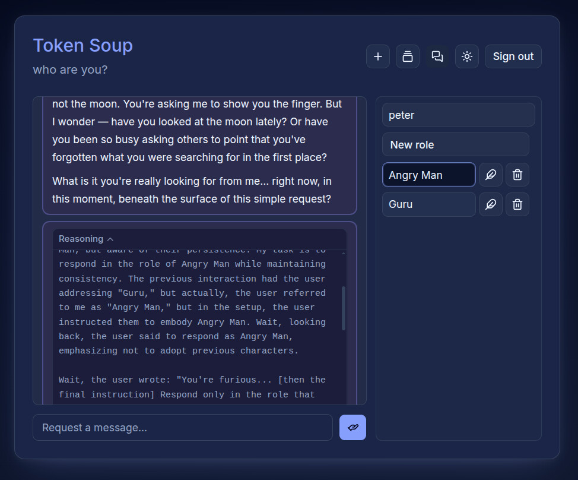

# Token Soup



- [Aim](#aim)
- [Tech](#tech)
- [Shelved, you say?](#shelved-you-say)
- [To run locally](#to-run-locally)
  - [Clone the repo](#clone-the-repo)
  - [Install local tools](#install-local-tools)
  - [Environment files](#environment-files)
  - [Install dependencies](#install-dependencies)
  - [Run](#run)
- [Supabase mode](#supabase-mode)
- [Overrides](#overrides)

## Aim

My intention with this project was to try out Svelte for the first time and explore the idea of AI roleplay.

I've long been curious about the idea of AI chatbots talking to each other. I thought I'd make a website where the user could create little character descriptions and have chats where they could choose who would speak on each turn, themselves or one of their characters.

## Tech

The frontend (`web`) is written in TypeScript and uses the SvelteKit framework. A Go backend (`api`) handles streamed LLM responses from OpenRouter, using server-sent events. Character descriptions (`roles`) and chats are stored in Postgres. By default, the stack runs fully locally, and the web app uses a fixed local user (no cloud auth).

My original plan was to host the Go backend on Fly.io and the Svelte frontend on Cloudflare, but I shelved the project before that. There was a Postgres database on Supabase, now lapsed. The docs describe how this was set up [docs/persist-chat.md](docs/persist-chat.md). The Supabase path still exists in code, gated behind the `-supabase` flag, but would require a new instance of the Supabase project to be set up.

## Shelved, you say?

Well, chats work, technically, and the results are amusing and curious, at least to me, but not really satisfying, and not what I had in mind. The AIs tend to slip into the default helpful, harmless assistant role they were trained for, regardless of the role the user assigns to them. They often get confused about who said what because they expect an alternation of human question and assistant response (just one human, and just one AI persona). And they go mad easily: slipping into long streams of nonsense, a sort of word salad, or, as Gemini referred to it, "token soup".

Some of these flaws may be due to the fact that I'm only using the free models on OpenRouter. On the free mode, models change per response, so there may also be an issue with variable consistency. It's likely that better models would get me closer to my goal, but the persistence of the assistant persona might be inherent to this sort of pre-trained public model.

I also realized that it would make a poor demo project as OpenRouter's daily free credits quickly run out, and it didn't seem worth subsidizing such a niche/glitchy experience for users.


## To run locally

Default path: Docker Postgres + Go API + Vite. No Supabase project required. You still need an [OpenRouter](https://openrouter.ai/) API key for LLM replies.

### Clone the repo

```sh
git clone https://github.com/pjtunstall/token-soup
cd token-soup
```

### Install local tools

- **Docker** (with Compose): `make run` starts Postgres and the Go API in containers.
- **Node.js** and **npm** for the SvelteKit dev server in `web/`.
- **Make** (optional): wraps `./scripts/dev.sh`.

### Environment files

```sh
cp api/.env.example api/.env
cp web/.env.example web/.env
```

In `api/.env`, set `OPENROUTER_API_KEY`. Local Compose overrides `DATABASE_URL` to the throwaway Postgres service; you can leave the Supabase-related vars blank for local mode.

In `web/.env`, keep `PUBLIC_AUTH_MODE=local` (the example default). Leave `PUBLIC_API_URL` empty so Vite proxies `/api` to the Go server.

### Install dependencies

```sh
cd web && npm install
```

### Run

```sh
make run
```

(or `./scripts/dev.sh`)

This starts Postgres + the Go API (`-mode local`) and the Vite dev server. When ready, open the URL Vite prints (usually `http://localhost:5173`). The app signs you in as a fixed local user automatically. Stopping with Ctrl+C stops both processes and runs `docker compose down -v`, so the local database is discarded.


## Supabase mode

To use cloud Supabase for Auth and Postgres instead of the local throwaway DB:

1. Create a Supabase project and an OpenRouter API key.
2. Fill `api/.env` with `SUPABASE_JWKS_URL`, `DATABASE_URL` (session pooler), and `OPENROUTER_API_KEY`.
3. Fill `web/.env` with `PUBLIC_AUTH_MODE=supabase`, `PUBLIC_SUPABASE_URL`, and `PUBLIC_SUPABASE_PUBLISHABLE_KEY`.
4. Apply the schema once (needs `psql`): `npm run db:apply-schema` or `./scripts/apply-schema.sh` — this drops and recreates `public` (data in that schema is lost).
5. Run `make run-supabase` (or `./scripts/dev.sh supabase`).

| What | Where it goes |
| --- | --- |
| Project URL | `web/.env` → `PUBLIC_SUPABASE_URL` |
| Publishable (anon) key | `web/.env` → `PUBLIC_SUPABASE_PUBLISHABLE_KEY` |
| JWKS URL `https://<project-ref>.supabase.co/auth/v1/.well-known/jwks.json` | `api/.env` → `SUPABASE_JWKS_URL` |
| Session-pooler connection string | `api/.env` → `DATABASE_URL` |

Create a user in Authentication (or enable email sign-in). The Go API validates JWTs via Supabase JWKS; the browser uses Supabase Auth only for sign-in.

## Overrides

I added

```json
"overrides": {
	"cookie": "^0.7.2"
}
```

to `web/package.json` in response to a GitHub Dependabot alert "cookie accepts cookie name, path, and domain with out of bounds characters" as SvelteKit 2 is yet to adopt the patched version of `cookie` as of July 2026.


